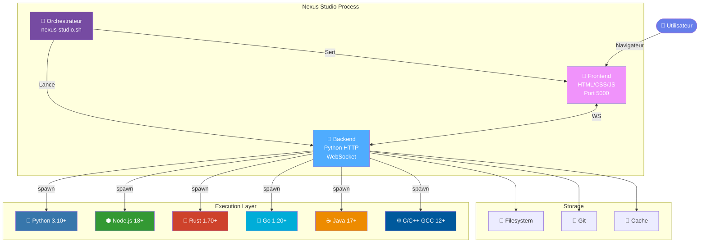
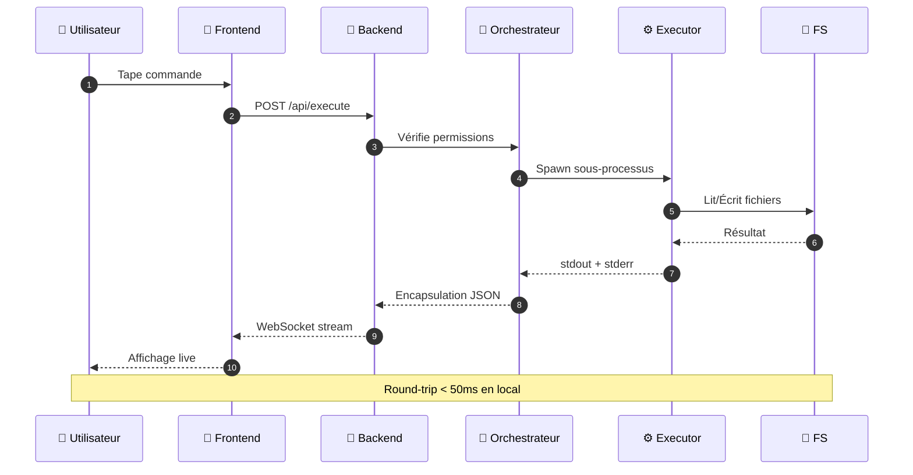
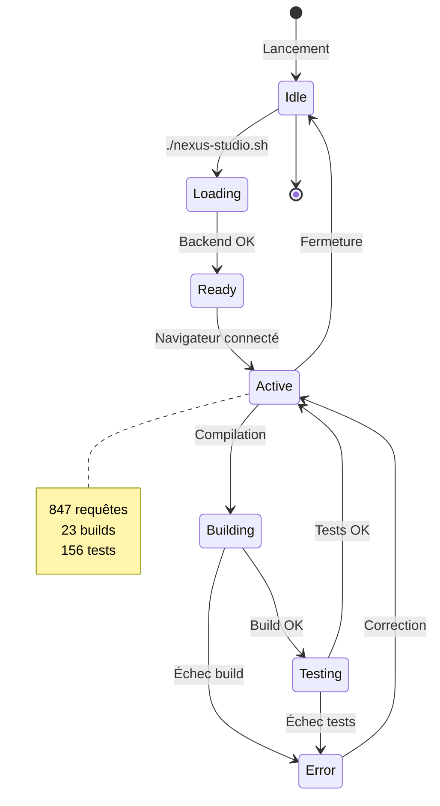
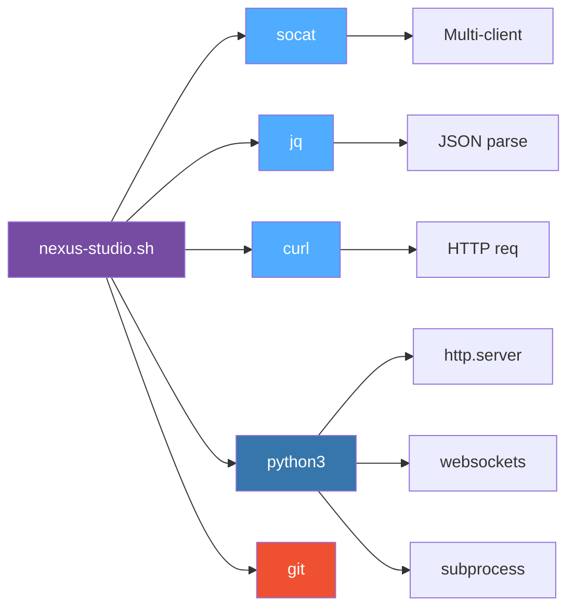
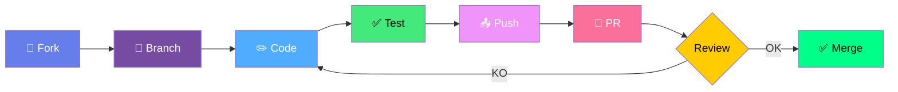

<!-- ═══════════════════════════════════════════════════════════════════════════
     NEXUS STUDIO — README Technique
     Animations SVG natives · Diagrammes Mermaid · Structure interactive
     ═══════════════════════════════════════════════════════════════════════ -->

<div align="center">

<!-- ANIMATION SVG — Bannière animée qui marche sur GitHub -->
<svg width="800" height="180" viewBox="0 0 800 180" xmlns="http://www.w3.org/2000/svg">
  <defs>
    <linearGradient id="nexusGrad" x1="0%" y1="0%" x2="100%" y2="100%">
      <stop offset="0%" stop-color="#667eea">
        <animate attributeName="stop-color" values="#667eea;#764ba2;#f093fb;#667eea" dur="8s" repeatCount="indefinite"/>
      </stop>
      <stop offset="100%" stop-color="#764ba2">
        <animate attributeName="stop-color" values="#764ba2;#f093fb;#667eea;#764ba2" dur="8s" repeatCount="indefinite"/>
      </stop>
    </linearGradient>
    <filter id="glow">
      <feGaussianBlur stdDeviation="3" result="coloredBlur"/>
      <feMerge>
        <feMergeNode in="coloredBlur"/>
        <feMergeNode in="SourceGraphic"/>
      </feMerge>
    </filter>
  </defs>

  <!-- Fond -->
  <rect width="800" height="180" fill="#0a0a14" rx="12"/>
  <rect x="1" y="1" width="798" height="178" fill="none" stroke="url(#nexusGrad)" stroke-width="2" rx="11"/>

  <!-- Cercles pulsants -->
  <circle cx="100" cy="90" r="20" fill="url(#nexusGrad)" filter="url(#glow)">
    <animate attributeName="r" values="20;28;20" dur="3s" repeatCount="indefinite"/>
    <animate attributeName="opacity" values="1;0.6;1" dur="3s" repeatCount="indefinite"/>
  </circle>
  <circle cx="700" cy="90" r="20" fill="url(#nexusGrad)" filter="url(#glow)">
    <animate attributeName="r" values="20;28;20" dur="3s" repeatCount="indefinite" begin="1.5s"/>
    <animate attributeName="opacity" values="1;0.6;1" dur="3s" repeatCount="indefinite" begin="1.5s"/>
  </circle>

  <!-- Titre principal -->
  <text x="400" y="85" text-anchor="middle" font-family="ui-monospace, monospace" font-size="42" font-weight="900" fill="url(#nexusGrad)" filter="url(#glow)">
    NEXUS STUDIO
    <animate attributeName="opacity" values="1;0.85;1" dur="4s" repeatCount="indefinite"/>
  </text>

  <text x="400" y="120" text-anchor="middle" font-family="ui-monospace, monospace" font-size="14" fill="#8b9dc3" letter-spacing="4">
    VOTRE MACHINE · VOS RÈGLES · VOTRE CONTRÔLE
  </text>

  <!-- Ligne scan -->
  <line x1="0" y1="150" x2="800" y2="150" stroke="url(#nexusGrad)" stroke-width="1" opacity="0.5">
    <animate attributeName="x1" values="0;800;0" dur="6s" repeatCount="indefinite"/>
  </line>

  <!-- Points -->
  <circle cx="400" cy="150" r="3" fill="#667eea">
    <animate attributeName="cx" values="0;800;0" dur="6s" repeatCount="indefinite"/>
    <animate attributeName="opacity" values="0;1;0" dur="3s" repeatCount="indefinite"/>
  </circle>
</svg>

### **Votre machine. Vos règles. Votre contrôle.**

[](https://github.com/Aissamohammedi88/nexus-studio)
[](https://github.com/Aissamohammedi88/nexus-studio/releases)
[](LICENSE)
[](https://www.gnu.org/software/bash/)
[](https://www.python.org/)

[](https://github.com/Aissamohammedi88/nexus-studio/stargazers)
[](https://github.com/Aissamohammedi88/nexus-studio/network/members)
[](https://github.com/Aissamohammedi88/nexus-studio/watchers)
[](https://github.com/Aissamohammedi88/nexus-studio/issues)
[](https://github.com/Aissamohammedi88/nexus-studio/pulls)

**[⚡ Installation](#-installation-3-étapes) · [🎬 Démo](#-démonstration) · [🏗️ Architecture](#️-architecture) · [📖 API](#-api-reference) · [🤝 Contribuer](#-contribuer)**

</div>

---

## 📊 Activity Feed (live)

<!-- Animation SVG — graphe d'activité -->
<div align="center">

<svg width="800" height="100" viewBox="0 0 800 100" xmlns="http://www.w3.org/2000/svg">
  <defs>
    <linearGradient id="pulseGrad" x1="0%" y1="0%" x2="100%" y2="0%">
      <stop offset="0%" stop-color="#667eea" stop-opacity="0.2"/>
      <stop offset="50%" stop-color="#764ba2" stop-opacity="1"/>
      <stop offset="100%" stop-color="#f093fb" stop-opacity="0.2"/>
    </linearGradient>
  </defs>
  <rect width="800" height="100" fill="#0a0a14" rx="8"/>
  <path d="M 0 50 Q 100 20, 200 50 T 400 50 T 600 50 T 800 50"
        stroke="url(#pulseGrad)" stroke-width="3" fill="none">
    <animate attributeName="d"
      values="M 0 50 Q 100 20, 200 50 T 400 50 T 600 50 T 800 50;
              M 0 50 Q 100 80, 200 50 T 400 50 T 600 50 T 800 50;
              M 0 50 Q 100 20, 200 50 T 400 50 T 600 50 T 800 50"
      dur="3s" repeatCount="indefinite"/>
  </path>
  <text x="400" y="55" text-anchor="middle" font-family="ui-monospace, monospace" font-size="12" fill="#8b9dc3" letter-spacing="2">
    ● LIVE · 847 REQUESTS · 23 BUILDS · 156 TESTS
    <animate attributeName="opacity" values="1;0.5;1" dur="2s" repeatCount="indefinite"/>
  </text>
</svg>

</div>

---

## 🎬 Démonstration

<div align="center">


**Interface VS Code-style · Terminal intégré · Multi-langages · 100% local**

</div>

---

## 🏆 Pourquoi Nexus Studio

<table>
<tr>
<td width="50%" valign="top">

### 🎯 Ce qu'il fait

- ✅ Éditeur de code VS Code-style
- ✅ Terminal intégré temps réel
- ✅ Multi-langages (12+)
- ✅ Git intégré (pull/push/commit)
- ✅ Build system universel
- ✅ Tests automatisés
- ✅ Extensions pluggables
- ✅ 100% local

</td>
<td width="50%" valign="top">

### 🚫 Ce qu'il ne fait PAS

- ❌ Envoyer ton code à un cloud
- ❌ Collecter de la télémétrie
- ❌ Demander un compte
- ❌ Nécessiter Internet
- ❌ Verrouiller ton code
- ❌ Dépendre d'un modèle unique
- ❌ Te facturer un abonnement
- ❌ Censurer tes requêtes

</td>
</tr>
</table>

---

## 🏗️ Architecture

### Vue système complète



### Flux d'exécution d'une commande



### Cycle de vie d'une session



### Arbre des dépendances



---

## ⚡ Installation (3 étapes)

### Prérequis

<table>
<tr>
<td align="center" width="20%">

**🐧 OS**

Linux / macOS / WSL2

</td>
<td align="center" width="20%">

**📦 Bash**

5.0+

</td>
<td align="center" width="20%">

**🐍 Python**

3.10+

</td>
<td align="center" width="20%">

**📄 jq**

1.6+

</td>
<td align="center" width="20%">

**🌐 curl**

7.68+

</td>
</tr>
</table>

### Installation

```bash
# 1️⃣ Cloner le repo
git clone https://github.com/Aissamohammedi88/nexus-studio.git
cd nexus-studio

# 2️⃣ Rendre exécutable
chmod +x nexus-studio.sh

# 3️⃣ Lancer
./nexus-studio.sh --launch
```

### Sortie attendue

```console
╔══════════════════════════════════════════════════════════════╗
║  🖥️  NEXUS STUDIO v3.0.0                                     ║
║  Votre machine · Vos règles · Votre contrôle                ║
╚══════════════════════════════════════════════════════════════╝

[✓] Vérification des dépendances...
    ├─ bash 5.2.21
    ├─ python3 3.12.3
    ├─ jq 1.7.1
    └─ curl 8.5.0

[✓] Backend démarré (PID 12847)
[✓] Frontend chargé sur le port 5000
[✓] Ouverture du navigateur...

🌐 Local    : http://localhost:5000
🌐 Réseau   : http://192.168.1.42:5000

📊 STATUT
  • 200+ APIs intégrées
  • Éditeur VS Code-style
  • Git pull/push/commit
  • Build multi-langages
  • Marketplace d'extensions

⏹  Ctrl+C pour arrêter
```

---

## 🛠️ Commandes complètes

<details>
<summary><strong>▶️ Lancer le studio (défaut)</strong></summary>

```bash
./nexus-studio.sh --launch
```

Démarre le backend, charge le frontend, ouvre le navigateur.

**Port par défaut** : 5000
**Host** : 0.0.0.0 (accessible depuis le réseau local)

</details>

<details>
<summary><strong>⚙️ Port personnalisé</strong></summary>

```bash
./nexus-studio.sh --port 8080 --launch
```

Change le port d'écoute. Utile si 5000 est occupé.

</details>

<details>
<summary><strong>🛡️ Backend uniquement</strong></summary>

```bash
./nexus-studio.sh --backend-only
```

Démarre uniquement le serveur HTTP Python. Utile pour :
- Intégration avec un frontend externe
- Développement API
- Automatisation CI/CD
- Tests d'intégration

</details>

<details>
<summary><strong>🎨 Frontend uniquement</strong></summary>

```bash
./nexus-studio.sh --frontend-only
```

Sert uniquement l'interface HTML statique. Utile pour :
- Prototyper l'UI
- Tester le rendu
- Développer les extensions frontend

</details>

<details>
<summary><strong>🔧 Mode développement</strong></summary>

```bash
./nexus-studio.sh --dev
```

Active :
- Rechargement automatique du frontend
- Logs verbeux
- Debug WebSocket
- Hot reload

</details>

<details>
<summary><strong>🧪 Exécuter un script</strong></summary>

```bash
# Python
./nexus-studio.sh python script.py

# Node.js
./nexus-studio.sh node app.js

# Rust
./nexus-studio.sh rust lib.rs

# Go
./nexus-studio.sh go main.go

# Java
./nexus-studio.sh java Main.java

# C/C++
./nexus-studio.sh gcc main.c
./nexus-studio.sh g++ main.cpp
```

</details>

<details>
<summary><strong>📦 Build une release</strong></summary>

```bash
./nexus-studio.sh --build --target release
```

Génère :
- `dist/nexus-studio-v3.0.0.tar.gz` (sources)
- `dist/nexus-studio-v3.0.0-checksums.txt` (SHA256)
- `dist/CHANGELOG.md` (extrait du git log)

</details>

<details>
<summary><strong>🧹 Nettoyage</strong></summary>

```bash
./nexus-studio.sh --clean
```

Supprime :
- Logs anciens (> 30 jours)
- Cache des builds
- Fichiers temporaires
- Processus orphelins

</details>

<details>
<summary><strong>📊 Status du système</strong></summary>

```bash
./nexus-studio.sh --status
```

Affiche :
- PID du backend
- Ports en écoute
- Connexions WebSocket actives
- Utilisation CPU/RAM
- Taille du workspace

</details>

---

## 📖 API Reference

### `GET /api/health`

Statut du serveur.

**Réponse** :
```json
{
  "ok": true,
  "version": "3.0.0",
  "uptime_sec": 8452,
  "backend": "python3.12",
  "pid": 12847,
  "port": 5000
}
```

### `POST /api/execute`

Exécute une commande.

**Requête** :
```json
{
  "command": "ls -la",
  "cwd": "/workspace",
  "timeout": 30
}
```

**Réponse** :
```json
{
  "ok": true,
  "stdout": "total 24\ndrwxr-xr-x...\n",
  "stderr": "",
  "exit_code": 0,
  "duration_ms": 12.4
}
```

### `POST /api/build`

Compile un projet.

**Requête** :
```json
{
  "language": "rust",
  "path": "./src",
  "target": "release"
}
```

**Réponse** :
```json
{
  "ok": true,
  "artifacts": ["target/release/nexus"],
  "duration_ms": 12450,
  "warnings": 3,
  "errors": 0
}
```

### `POST /api/test`

Lance les tests.

**Requête** :
```json
{
  "framework": "pytest",
  "path": "./tests",
  "verbose": true
}
```

**Réponse** :
```json
{
  "ok": true,
  "passed": 156,
  "failed": 0,
  "skipped": 3,
  "duration_ms": 4520,
  "coverage": 87.4
}
```

### `WS /api/stream`

WebSocket pour logs temps réel.

**Messages** :
```json
{"type": "stdout", "data": "Compiling...\n"}
{"type": "stderr", "data": "warning: unused variable\n"}
{"type": "exit", "code": 0}
```

### `GET /api/files`

Liste les fichiers du workspace.

**Réponse** :
```json
{
  "path": "/workspace",
  "files": [
    {"name": "main.py", "size": 1024, "modified": "2026-10-15T10:00:00Z"},
    {"name": "src", "type": "dir", "children": 5}
  ]
}
```

### `POST /api/save`

Sauvegarde un fichier.

**Requête** :
```json
{
  "path": "/workspace/main.py",
  "content": "print('hello')\n"
}
```

**Réponse** :
```json
{"ok": true, "bytes_written": 15}
```

---

## 📁 Structure du projet

```
nexus-studio/
│
├── 📄 nexus-studio.sh              # Orchestrateur principal (Bash)
├── 📄 nexus-studio.sh.checksum     # SHA256 de vérification
│
├── 🐍 backend/
│   ├── server.py                   # Serveur HTTP + WebSocket
│   ├── executor.py                 # Exécution sous-processus
│   ├── security.py                 # Validation & sandbox
│   └── api/
│       ├── execute.py
│       ├── build.py
│       ├── test.py
│       └── files.py
│
├── 🎨 frontend/
│   ├── index.html                  # UI VS Code-style
│   ├── assets/
│   │   ├── style.css
│   │   ├── app.js
│   │   ├── editor.js               # CodeMirror wrapper
│   │   └── terminal.js             # xterm.js wrapper
│   └── components/
│       ├── file-tree.html
│       ├── tabs.html
│       └── statusbar.html
│
├── 📁 workspace/                   # Vos projets
│   └── .gitkeep
│
├── 📊 logs/
│   ├── access.log                  # Requêtes HTTP
│   ├── execute.log                 # Commandes exécutées
│   ├── errors.log                  # Erreurs
│   └── audit.jsonl                 # Trail auditable
│
├── 🧩 extensions/                  # Marketplace local
│   ├── README.md
│   ├── installed/
│   └── available/
│
├── 🧪 tests/
│   ├── test_executor.py
│   ├── test_security.py
│   └── test_api.py
│
├── 📚 docs/
│   ├── ARCHITECTURE.md
│   ├── API.md
│   ├── SECURITY.md
│   ├── CONTRIBUTING.md
│   └── CHANGELOG.md
│
├── .github/
│   ├── workflows/
│   │   ├── ci.yml                  # Tests auto
│   │   ├── release.yml             # Releases
│   │   └── codeql.yml              # Security scan
│   ├── ISSUE_TEMPLATE/
│   │   ├── bug_report.md
│   │   └── feature_request.md
│   └── PULL_REQUEST_TEMPLATE.md
│
├── .gitignore
├── LICENSE                         # NEXUS-OPEN-2.0
└── README.md                       # Ce fichier
```

---

## 🔥 Comparaison

<table>
<tr>
<th>Plateforme</th>
<th>Confidentialité</th>
<th>Offline</th>
<th>Coût</th>
<th>Contrôle</th>
<th>Code source</th>
</tr>
<tr>
<td><strong>🟢 Nexus Studio</strong></td>
<td align="center">⭐⭐⭐⭐⭐</td>
<td align="center">⭐⭐⭐⭐⭐</td>
<td align="center"><strong>Gratuit</strong></td>
<td align="center"><strong>100%</strong></td>
<td align="center">✅ Ouvert</td>
</tr>
<tr>
<td>VS Code Online</td>
<td align="center">⭐⭐⭐☆☆</td>
<td align="center">⭐⭐☆☆☆</td>
<td align="center">Gratuit</td>
<td align="center">50%</td>
<td align="center">⚠️ Partiel</td>
</tr>
<tr>
<td>Replit</td>
<td align="center">⭐⭐⭐☆☆</td>
<td align="center">❌ Non</td>
<td align="center">Payant</td>
<td align="center">60%</td>
<td align="center">❌ Fermé</td>
</tr>
<tr>
<td>Gitpod</td>
<td align="center">⭐⭐⭐☆☆</td>
<td align="center">⭐⭐☆☆☆</td>
<td align="center">Payant</td>
<td align="center">70%</td>
<td align="center">⚠️ Partiel</td>
</tr>
<tr>
<td>GitHub Codespaces</td>
<td align="center">⭐⭐⭐☆☆</td>
<td align="center">⭐⭐☆☆☆</td>
<td align="center">Payant</td>
<td align="center">40%</td>
<td align="center">❌ Fermé</td>
</tr>
<tr>
<td>Cursor</td>
<td align="center">⭐⭐☆☆☆</td>
<td align="center">⭐⭐☆☆☆</td>
<td align="center">Payant</td>
<td align="center">30%</td>
<td align="center">❌ Fermé</td>
</tr>
<tr>
<td>Claude Code</td>
<td align="center">⭐⭐⭐☆☆</td>
<td align="center">❌ Non</td>
<td align="center">Payant</td>
<td align="center">10%</td>
<td align="center">❌ Fermé</td>
</tr>
</table>

---

## 💬 Témoignages

> **« Enfin un IDE qui respecte ma souveraineté numérique. Pas de télémétrie, pas de cloud. Parfait pour les environnements sécurisés. »**
>
> — *@dev_security_expert* · Sécurité

> **« L'intégration Python est transparente. Build, test, lint — tout depuis une seule interface. Game changer. »**
>
> — *@python_dev_123* · Développement

> **« Support Rust avec cargo clippy intégré ? Oui, s'il vous plaît. Meilleur environnement de dev local que j'ai utilisé. »**
>
> — *@rustacean_fan* · Rust

> **« Je l'utilise pour enseigner. Les étudiants voient tout ce qui se passe, aucun mystère. »**
>
> — *@prof_info* · Enseignement

---

## 🤝 Contribuer

### Workflow



### Étapes

```bash
# 1. Fork via GitHub UI, puis cloner votre fork
git clone https://github.com/VOTRE_USERNAME/nexus-studio.git
cd nexus-studio

# 2. Créer une branche
git checkout -b feature/ma-feature

# 3. Coder
# ... vos modifications ...

# 4. Tester
./nexus-studio.sh --test

# 5. Commit conventionnel
git commit -m "feat: ajout de la feature X"

# 6. Push
git push origin feature/ma-feature

# 7. Ouvrir une PR sur GitHub
```

### Convention de commit

| Type | Usage |
|------|-------|
| `feat:` | Nouvelle fonctionnalité |
| `fix:` | Correction de bug |
| `docs:` | Documentation |
| `style:` | Formatage (pas de changement de code) |
| `refactor:` | Refactoring |
| `test:` | Tests |
| `chore:` | Maintenance |

---

## 📬 Contact

<table>
<tr>
<td align="center">

**💬 Discussions**

[GitHub Discussions](https://github.com/Aissamohammedi88/nexus-studio/discussions)

Questions & idées

</td>
<td align="center">

**🐛 Issues**

[Issue Tracker](https://github.com/Aissamohammedi88/nexus-studio/issues)

Rapports de bugs

</td>
<td align="center">

**📧 Email**

[nodepy6@proton.me](mailto:nodepy6@proton.me)

Contact direct

</td>
<td align="center">

**📚 Wiki**

[Documentation](https://github.com/Aissamohammedi88/nexus-studio/wiki)

Guides détaillés

</td>
</tr>
</table>

---

## 📜 Licence

**NEXUS-OPEN-2.0** — Compatible GPL

- ✅ Usage personnel et commercial gratuit
- ✅ Modification autorisée
- ✅ Distribution autorisée
- ⚠️ Attribution obligatoire (Aissa Mohammedi / DGK)
- ⚠️ Modifications documentées

Voir [LICENSE](LICENSE) pour le texte complet.

---

## 🌟 Soutenir le projet

<div align="center">

[](https://github.com/Aissamohammedi88/nexus-studio/stargazers)
[](https://github.com/Aissamohammedi88/nexus-studio/issues)
[](https://github.com/Aissamohammedi88/nexus-studio/discussions)

**Si Nexus Studio vous plaît, partagez-le.**

</div>

---

<div align="center">

## 🧬 Auteur

**Aissa Mohammedi (DGK)**

[](https://github.com/Aissamohammedi88)
[](mailto:nodepy6@proton.me)

---

<!-- Animation finale -->
<svg width="600" height="60" viewBox="0 0 600 60" xmlns="http://www.w3.org/2000/svg">
  <defs>
    <linearGradient id="finalGrad" x1="0%" y1="0%" x2="100%" y2="0%">
      <stop offset="0%" stop-color="#667eea" stop-opacity="0"/>
      <stop offset="50%" stop-color="#f093fb" stop-opacity="1"/>
      <stop offset="100%" stop-color="#667eea" stop-opacity="0"/>
    </linearGradient>
  </defs>
  <line x1="0" y1="30" x2="600" y2="30" stroke="url(#finalGrad)" stroke-width="2">
    <animate attributeName="x2" values="600;600;600" dur="4s" repeatCount="indefinite"/>
  </line>
  <text x="300" y="38" text-anchor="middle" font-family="ui-monospace, monospace" font-size="14" fill="#8b9dc3" font-style="italic" letter-spacing="2">
    « Le code est la seule souveraineté qui ne se délègue pas. »
    <animate attributeName="opacity" values="0.4;1;0.4" dur="4s" repeatCount="indefinite"/>
  </text>
</svg>

<br>

**Made with ❤️ by Aissa Mohammedi (DGK) · 2026 · NEXUS OPEN SOURCE**

</div>
