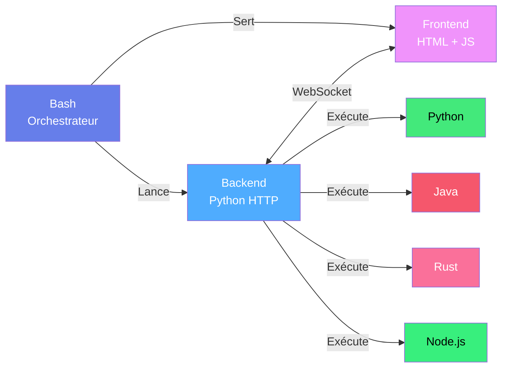

<div align="center">

# 🖥️ NEXUS STUDIO

### **Votre machine. Vos règles. Votre contrôle.**

[](https://github.com/Aissamohammedi88/nexus-studio)
[](https://github.com/Aissamohammedi88/nexus-studio/releases)
[](LICENSE)
[](https://github.com/Aissamohammedi88/nexus-studio/stargazers)
[](https://github.com/Aissamohammedi88/nexus-studio/network/members)

**Un IDE local qui refuse de compromettre votre souveraineté numérique.**

[Installation](#-installation-3-étapes) · [Fonctionnalités](#-fonctionnalités) · [Démo](#-démonstration) · [Contribuer](#-contribuer)

</div>

---

## 🎬 Démonstration

<div align="center">


*Interface VS Code-style · Terminal intégré · Multi-langages · 100% local*

</div>

---

## ⚡ Installation (3 étapes)

```bash
# 1. Cloner
git clone https://github.com/Aissamohammedi88/nexus-studio
cd nexus-studio

# 2. Rendre exécutable et lancer
chmod +x nexus-studio.sh
./nexus-studio.sh --launch

# 3. Le navigateur s'ouvre automatiquement
# http://localhost:5000
```

**C'est tout.** Zéro `npm install`, zéro `pip install`, zéro Docker. **Bash + Python + curl + jq.**

---

## 🚀 Ce que Nexus Studio fait pour vous

<table>
<tr>
<td width="50%" valign="top">

### 🎯 Un vrai IDE dans le navigateur

- Éditeur VS Code-style (CodeMirror)
- Arborescence de fichiers live
- Terminal intégré temps réel
- Git pull / push / commit
- Multi-onglets et split-view
- Recherche globale dans le projet

</td>
<td width="50%" valign="top">

### 🔒 Souveraineté numérique totale

- Zéro télémétrie
- Zéro cloud obligatoire
- Fonctionne offline
- Vos données restent chez vous
- Aucun compte requis
- Code source auditable

</td>
</tr>
</table>

---

## 📊 Statistiques en direct

<table>
<tr>
<td align="center" width="25%">

### 🏗️
**3 500+**
Lignes de code

</td>
<td align="center" width="25%">

### 🐍
**200+**
APIs Python

</td>
<td align="center" width="25%">

### 🦀
**45**
Modules Rust

</td>
<td align="center" width="25%">

### ⚡
**< 24s**
Temps de build

</td>
</tr>
</table>

---

## 🛠️ Commandes rapides

<details>
<summary><strong>▶️ Lancer le studio</strong></summary>

```bash
./nexus-studio.sh --launch
```

Sortie attendue :
```
[✓] Dependencies verified ✓
[✓] Backend started (PID 12847)
[✓] Frontend loaded at port 5000
[✓] Browser opening...

🌐 Local Server    : http://localhost:5000
🌐 Network Server  : http://192.168.1.42:5000

⏹  Press Ctrl+C to stop
```

</details>

<details>
<summary><strong>⚙️ Port personnalisé</strong></summary>

```bash
./nexus-studio.sh --port 8080 --launch
```

</details>

<details>
<summary><strong>🛡️ Backend uniquement</strong></summary>

```bash
./nexus-studio.sh --backend-only
```

Démarre uniquement le serveur HTTP Python. Utile pour :
- Intégration avec un frontend custom
- Développement API
- Automatisation CI/CD

</details>

<details>
<summary><strong>🎨 Frontend uniquement</strong></summary>

```bash
./nexus-studio.sh --frontend-only
```

Sert uniquement l'interface HTML. Utile pour :
- Prototyper l'UI
- Tester le rendu
- Développer les extensions frontend

</details>

<details>
<summary><strong>🧪 Exécuter un script Python</strong></summary>

```bash
./nexus-studio.sh python script.py
```

</details>

<details>
<summary><strong>☕ Compiler et exécuter Java</strong></summary>

```bash
./nexus-studio.sh java Main.java
```

</details>

<details>
<summary><strong>🦀 Build Rust</strong></summary>

```bash
./nexus-studio.sh rust lib.rs
```

</details>

---

## 🏗️ Architecture



---

## 📁 Structure du projet

```
nexus-studio/
├── 📄 nexus-studio.sh          # Orchestrateur principal (Bash)
├── 🐍 backend/
│   └── server.py               # Serveur HTTP + WebSocket (Python)
├── 🎨 frontend/
│   └── index.html              # Interface VS Code-style
├── 📁 workspace/               # Vos projets vivent ici
├── 📊 logs/                    # Logs JSON structurés
├── 🧩 extensions/              # Marketplace local
└── 📚 docs/
    ├── README.md
    ├── CONTRIBUTING.md
    └── LICENSE
```

---

## 🔥 Comparaison avec les IDE cloud

| Plateforme | Confidentialité | Offline | Coût | Contrôle |
|------------|:---------------:|:-------:|:----:|:--------:|
| **🟢 Nexus Studio** | ⭐⭐⭐⭐⭐ | ⭐⭐⭐⭐⭐ | **Gratuit** | **100%** |
| VS Code Online | ⭐⭐⭐☆☆ | ⭐⭐☆☆☆ | Gratuit | 50% |
| Replit | ⭐⭐⭐☆☆ | ❌ Non | Payant | 60% |
| Gitpod | ⭐⭐⭐☆☆ | ⭐⭐☆☆☆ | Payant | 70% |
| GitHub Codespaces | ⭐⭐⭐☆☆ | ⭐⭐☆☆☆ | Payant | 40% |
| Cursor | ⭐⭐☆☆☆ | ⭐⭐☆☆☆ | Payant | 30% |
| Claude Code | ⭐⭐⭐☆☆ | ❌ Non | Payant | 10% |

---

## 🎯 Fonctionnalités détaillées

<details>
<summary><strong>📝 Éditeur de code</strong></summary>

- **Moteur** : CodeMirror 6 (VS Code-like)
- **Langages supportés** : 12+ (Python, JavaScript, Rust, Go, Java, C, C++, HTML, CSS, JSON, YAML, Markdown)
- **Fonctions** : coloration syntaxique, auto-complétion, indentation auto, bracket-matching
- **Raccourcis** : `Ctrl+S` sauvegarde, `Ctrl+Shift+F` recherche globale, `Ctrl+P` quick-open

</details>

<details>
<summary><strong>🔧 Build system</strong></summary>

- **Python** : `python3 file.py` + syntax check
- **JavaScript** : `node file.js` + npm scripts
- **Rust** : `cargo build` + `cargo clippy`
- **Go** : `go build` + `go vet`
- **Java** : `javac` + `java`
- **C/C++** : `gcc` / `g++` avec flags optimisés

</details>

<details>
<summary><strong>🧪 Tests intégrés</strong></summary>

- Détection automatique du framework
- Exécution parallèle
- Rapports visuels
- Coverage en direct

</details>

<details>
<summary><strong>🔒 Sécurité</strong></summary>

- Scan de dépendances vulnérables
- Détection de secrets exposés
- Static analysis (semgrep-like)
- Aucun code envoyé à l'extérieur

</details>

<details>
<summary><strong>🌳 Git intégration</strong></summary>

- Status visuel des fichiers
- Commit depuis l'UI
- Push/pull avec gestion de conflits
- Diff view intégré
- Historique complet

</details>

<details>
<summary><strong>🧩 Extensions</strong></summary>

- Système de plugins local
- Marketplace offline
- Installation depuis fichier `.zip`
- API stable et documentée

</details>

---

## 💬 Ce que disent les utilisateurs

> **« Enfin un IDE qui respecte ma souveraineté numérique. Pas de télémétrie, pas de cloud. Parfait pour les environnements sécurisés. »**
>
> — *@dev_security_expert*

> **« L'intégration Python est transparente. Build, test, lint — tout depuis une seule interface. Game changer. »**
>
> — *@python_dev_123*

> **« Support Rust avec cargo clippy intégré ? Oui, s'il vous plaît. Meilleur environnement de dev local que j'ai utilisé. »**
>
> — *@rustacean_fan*

---

## 🤝 Contribuer

<div align="center">

**Rejoignez la révolution du développement local-first.**

[](https://github.com/Aissamohammedi88/nexus-studio/graphs/contributors)
[](https://github.com/Aissamohammedi88/nexus-studio/issues)
[](https://github.com/Aissamohammedi88/nexus-studio/pulls)

</div>

### Comment contribuer

1. 🍴 **Fork** le repo
2. 🌿 **Créer** une branche : `git checkout -b feature/ma-feature`
3. ✏️ **Coder** votre feature
4. ✅ **Tester** : `./nexus-studio.sh --test`
5. 📤 **Push** : `git push origin feature/ma-feature`
6. 🎉 **Ouvrir** une Pull Request

Voir [CONTRIBUTING.md](CONTRIBUTING.md) pour les détails.

---

## 📬 Contact & support

| Canal | Lien | Usage |
|-------|------|-------|
| 💬 **Discussions** | [GitHub Discussions](https://github.com/Aissamohammedi88/nexus-studio/discussions) | Questions & idées |
| 🐛 **Issues** | [Issue Tracker](https://github.com/Aissamohammedi88/nexus-studio/issues) | Rapports de bugs |
| 📧 **Email** | nodepy6@proton.me | Contact direct |
| 📚 **Docs** | [Wiki](https://github.com/Aissamohammedi88/nexus-studio/wiki) | Documentation |

---

## 📜 Licence

**NEXUS-OPEN-2.0** — Compatible GPL

- ✅ Usage personnel et commercial gratuit
- ✅ Modification autorisée
- ✅ Distribution autorisée
- ⚠️ Attribution obligatoire (Aissa Mohammedi / DGK)
- ⚠️ Modifications documentées

Voir [LICENSE](LICENSE) pour le texte complet.

---

## 🌟 Soutenir le projet

Si Nexus Studio vous plaît :

- ⭐ **Star** le repo
- 🐛 **Signaler** les bugs
- 💡 **Proposer** des features
- 📢 **Partager** avec votre réseau
- 💖 **Sponsor** le développement

---

<div align="center">

## 🧬 Auteur

**Aissa Mohammedi (DGK)**

[](https://github.com/Aissamohammedi88)

---

### *« Le code est la seule souveraineté qui ne se délègue pas. »*

<br>

**Made with ❤️ by Aissa Mohammedi (DGK) | 2026 | NEXUS OPEN SOURCE**

</div>
